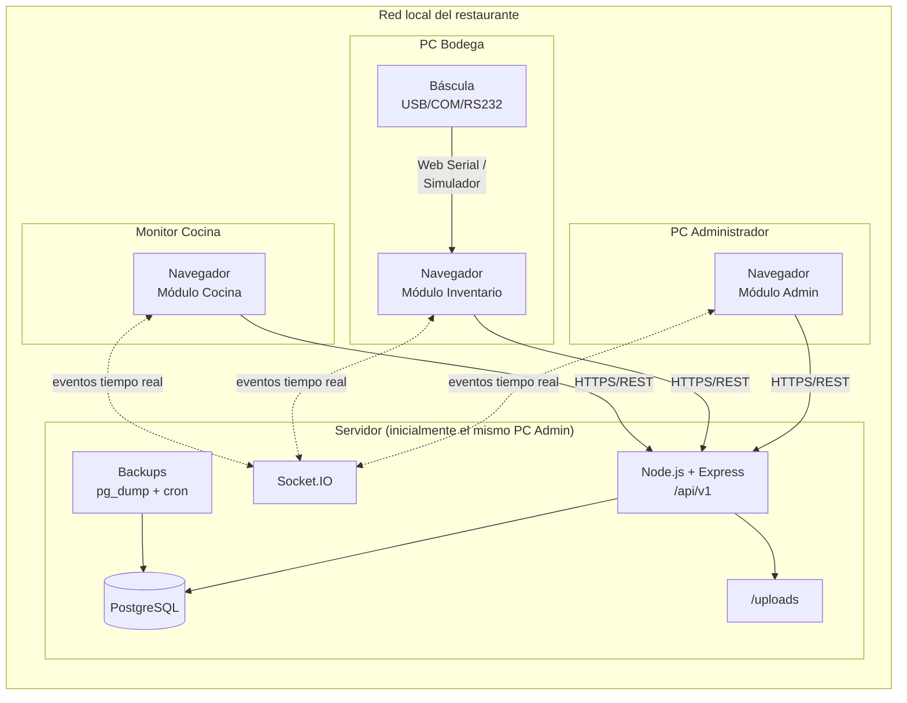

# Fase 2 — Arquitectura
## Sistema ERP para Restaurante ("Sistema Gaby")

**Versión:** 1.0 · **Fecha:** 2026-07-06 · **Estado:** Pendiente de aprobación
**Depende de:** `01-analisis-funcional.md` (aprobado)

---

## 1. Decisiones arquitectónicas (resumen tipo ADR)

| # | Decisión | Alternativa descartada | Justificación |
|---|---|---|---|
| AD-01 | **Monolito modular** con Clean Architecture | Microservicios | Un solo restaurante, un solo equipo, despliegue local. Microservicios agregarían complejidad operativa (orquestación, red, consistencia) sin ningún beneficio a esta escala. El monolito modular da los mismos límites lógicos entre módulos y permite extraer servicios en el futuro si algún día hace falta. |
| AD-02 | **Monorepo con npm workspaces**: `client`, `server`, `shared` | Repos separados | Tipos y contratos (DTOs, eventos de socket, permisos) compartidos entre front y back sin duplicación ni drift. Un solo `npm install`, un solo control de versiones. |
| AD-03 | Backend en **4 capas**: `domain → application → infrastructure → presentation` | MVC plano | El dominio (recetas, costeo, tolerancias, FEFO) no conoce Express, Prisma ni Socket.IO. Permite cambiar ORM, transporte o BD sin tocar reglas de negocio (RNF-02, RNF-04). |
| AD-04 | **Prisma + PostgreSQL** vía `DATABASE_URL` | — (requisito) | Migrar de localhost a LAN/VPS/nube = cambiar una variable de entorno. Repositorios implementan interfaces del dominio: la lógica nunca importa Prisma directamente. |
| AD-05 | **REST versionado (`/api/v1`) para comandos/consultas + Socket.IO solo para notificar** | Todo por WebSocket | REST es cacheable, testeable y estándar. El socket **nunca muta estado**: solo avisa "algo cambió" y el cliente re-consulta vía React Query. Evita divergencia de estado y duplicación de lógica de autorización. |
| AD-06 | **`ScaleService` en el frontend** (pantalla Inventario) con drivers intercambiables; **validación de tolerancia en el backend** | Báscula conectada al servidor | La báscula está físicamente conectada al PC de bodega, no al servidor. Web Serial API (Chromium) lee COM/RS232/USB-serial desde el navegador sin instalar nada. El backend re-valida tolerancia y registra auditoría: el cliente jamás decide si una entrega es válida. Báscula Ethernet: driver TCP en backend con proxy al cliente (futuro). |
| AD-07 | **Auditoría como decorador de casos de uso** | Triggers de BD / llamadas manuales | Cada caso de uso mutador pasa por un interceptor que registra actor, acción, entidad y diff. Imposible de olvidar (RN-07), sin ensuciar la lógica de negocio. |
| AD-08 | JWT **access corto (15 min) + refresh con rotación** en cookie httpOnly | Access token largo | Estándar de seguridad; sesiones revocables (tabla de refresh tokens); el mismo access token autentica el handshake de Socket.IO. |
| AD-09 | **Zod como fuente única de validación**, esquemas en `shared` | Validar solo en back | Los mismos esquemas validan formularios (React Hook Form + zodResolver) y requests (middleware Express). Cero duplicación (regla del proyecto). |
| AD-10 | Estado en frontend: **React Query = estado del servidor; Zustand = solo estado de UI** | Todo en Zustand | React Query maneja caché, revalidación e invalidación por eventos de socket. Zustand queda para tema, sidebar, sesión. Evita el clásico "estado servidor duplicado a mano". |
| AD-11 | Logging estructurado con **pino**; errores con jerarquía `AppError` y envelope único de respuesta | console.log | Diagnóstico serio en producción local; códigos de error estables que el front puede mapear a mensajes en español. |
| AD-12 | Respaldos con **`pg_dump` orquestado por el server** (node-cron) + scripts manuales | Herramienta externa | Sin dependencias externas (RNF-01); programables y restaurables desde la UI de administración. |

---

## 2. Vista general del sistema



En v1 todo puede correr en **un solo PC** (frontend `:5173`, backend `:3000`, PostgreSQL `:5432`).
Migrar a servidor LAN/VPS = mover el server y cambiar `VITE_API_URL` y `DATABASE_URL`. Nada más.

---

## 3. Estructura de carpetas

```
Sistema Gaby/
├── client/                      # Frontend — React 19 + Vite + TS
├── server/                      # Backend — Node + Express + TS
├── shared/                      # Contratos compartidos (workspace npm)
├── database/                    # schema.prisma, migraciones, seed, diagrama ER
├── docs/                        # Documentación por fase y por módulo
├── scripts/                     # Instalación, arranque, backup/restore
├── uploads/                     # Imágenes de recetas, comprobantes (git-ignored)
├── backups/                     # Dumps de PostgreSQL (git-ignored)
├── package.json                 # Workspaces: client, server, shared
└── .env.example                 # Plantilla de variables de entorno
```

### 3.1 `server/` — Clean Architecture

```
server/src/
├── domain/                      # ❤ Núcleo. Cero dependencias externas.
│   ├── entities/                #   Receta, Producto, Lote, OrdenProduccion, Entrega…
│   ├── value-objects/           #   Dinero, Peso, Tolerancia, Unidad (con conversión)
│   ├── services/                #   Costeo promedio ponderado, explosión de recetas, FEFO
│   ├── repositories/            #   Interfaces (puertos): IRecetaRepository, …
│   └── errors/                  #   DomainError y derivados
│
├── application/                 # Casos de uso. Depende solo de domain.
│   ├── use-cases/               #   Por módulo: production/ConfirmarProduccion.ts, …
│   ├── dto/                     #   Entrada/salida de casos de uso
│   ├── ports/                   #   IEventBus, IClock, IHasher, ITokenService, IBackupService
│   └── decorators/              #   withAudit(), withTransaction()
│
├── infrastructure/              # Adaptadores. Implementa puertos.
│   ├── database/                #   PrismaClient, repositorios Prisma, unit of work
│   ├── auth/                    #   JwtTokenService, Argon2Hasher
│   ├── realtime/                #   SocketIoEventBus (implementa IEventBus)
│   ├── backup/                  #   PgDumpBackupService + node-cron
│   ├── files/                   #   Almacenamiento local de uploads
│   └── logging/                 #   Pino
│
├── presentation/                # HTTP + WS. Depende de application.
│   ├── http/
│   │   ├── routes/              #   Un router por módulo
│   │   ├── controllers/         #   Delgados: parsean → caso de uso → responden
│   │   └── middleware/          #   auth, permisos, validación Zod, errores, rate-limit
│   └── ws/                      #   Handshake JWT, salas por rol, emisores
│
├── container.ts                 # Inyección de dependencias (composición manual tipada)
├── config/                      # Carga y validación de env (Zod) — falla rápido
└── main.ts                      # Bootstrap
```

**Regla de dependencias (inviolable):** `presentation → application → domain` e
`infrastructure → application/domain`. El dominio no importa nada de fuera.

### 3.2 `client/` — arquitectura por features

```
client/src/
├── app/                         # Bootstrap: router, providers, guards por rol
├── features/                    # Un folder por módulo funcional
│   ├── auth/  ├── dashboard/  ├── recipes/  ├── inventory/
│   ├── production/  ├── delivery/   # pantalla bodega (báscula)
│   ├── kitchen/  ├── expenses/  ├── sales/  ├── reports/
│   ├── audit/  ├── users/  └── backups/
│   │   └── (cada una: components/, hooks/, api.ts, schemas → de shared)
├── components/ui/               # shadcn/ui
├── components/common/           # DataTable, PageHeader, ConfirmDialog, EmptyState…
├── lib/                         # apiClient (fetch tipado), socket, utils, formato COP
├── services/scale/              # ⚖ ScaleService + drivers (ver §6)
├── stores/                      # Zustand: sesión, tema, UI
└── styles/
```

### 3.3 `shared/` — el contrato

```
shared/src/
├── schemas/        # Zod: validación única front+back (AD-09)
├── types/          # DTOs inferidos de Zod, enums (estados, roles, unidades)
├── events/         # Catálogo tipado de eventos Socket.IO (nombre + payload)
├── permissions/    # Matriz recurso×acción y helpers can(user, action, resource)
└── constants/      # Tolerancia default, categorías, códigos de error
```

---

## 4. Flujo de una petición (patrón único para todo el sistema)

```
Request → middleware auth (JWT) → middleware permisos (shared/permissions)
→ middleware validación (Zod de shared) → Controller (delgado)
→ Use Case [withTransaction + withAudit] → Entidades/Servicios de dominio
→ Repositorios (interfaces → Prisma) → commit
→ IEventBus.publish(evento) → Socket.IO emite a las salas
→ Respuesta { data } | { error: { code, message, details } }
```

- **Transacción por caso de uso:** confirmar una entrega descuenta lotes (FEFO), crea el
  movimiento, actualiza la orden y audita — todo o nada.
- **Auditoría automática (AD-07):** el decorador captura usuario, IP, acción, entidad,
  estado antes/después. Los casos de uso no saben que son auditados.
- **Eventos después del commit:** nunca se notifica algo que pudo hacer rollback.

## 5. Tiempo real — catálogo de eventos

Namespace único `/realtime`, autenticado con el JWT en el handshake. Salas por rol:
`room:admin`, `room:inventory`, `room:kitchen`, `room:auditor`.

| Evento | Emisor | Destinos | Efecto en cliente |
|---|---|---|---|
| `production:confirmed` | Confirmar producción | inventory, kitchen, admin | Aparece la orden del día |
| `production:status-changed` | Transiciones RF-04.5 | todos | Actualiza estado |
| `delivery:completed` | Entrega aprobada | admin, kitchen | Progreso de insumos |
| `delivery:blocked` | Fuera de tolerancia | admin | Alerta + auditoría |
| `stock:low` / `stock:expiring` | Movimientos / cron diario | admin | Centro de alertas |
| `recipe:cost-changed` | Recálculo en cascada | admin | Refresca costos vigentes |
| `sales:registered` / `expense:created` | CRUD | admin | KPIs del dashboard |

**Patrón cliente:** cada evento invalida las queries de React Query correspondientes
(`queryClient.invalidateQueries(...)`). El payload del socket es mínimo (ids); los datos
siempre se re-obtienen del REST → una sola fuente de verdad, una sola capa de autorización.

## 6. `ScaleService` — capa de abstracción de báscula

```ts
// shared/types + client/services/scale
interface ScaleReading { weightKg: number; stable: boolean; timestamp: number }

interface ScaleDriver {
  connect(): Promise<void>;
  disconnect(): Promise<void>;
  readonly status: 'disconnected' | 'connecting' | 'connected' | 'error';
  onReading(cb: (r: ScaleReading) => void): Unsubscribe;
  tare(): Promise<void>;
}

class ScaleService {
  constructor(driver: ScaleDriver, opts: { stableSamples: number; stableDeltaKg: number });
  /** Resuelve solo cuando hay N lecturas consecutivas dentro del delta (RF-06.4) */
  captureStableWeight(timeoutMs?: number): Promise<ScaleReading>;
}
```

**Drivers:**
1. `SimulatorDriver` (v1): panel flotante en la pantalla de bodega — fijar peso objetivo,
   fluctuación realista, simular desconexión/error. Solo visible con `VITE_SCALE_DRIVER=simulator`.
2. `WebSerialDriver` (futuro, sin reescribir nada): Web Serial API de Chromium lee
   COM/RS232/USB-serial directamente desde el navegador; el parsing por protocolo del
   fabricante (Toledo, CAS, etc.) se aísla en un `ProtocolParser` inyectable.
3. `NetworkDriver` (futuro): básculas Ethernet vía backend (TCP) con streaming al cliente.

**Seguridad del peso (RN-01):** el cliente envía `{ peso, driver, lecturas }` al backend;
el **backend** valida tolerancia contra lo requerido, decide aprobar/bloquear y audita.
La UI no tiene ningún input numérico de peso.

## 7. Autenticación y autorización

- Login → **access token JWT (15 min)** en memoria + **refresh token (7 días, rotativo)**
  en cookie httpOnly. Tabla `sessions` permite revocar sesiones desde administración.
- Bloqueo tras N intentos fallidos (RF-01.5) con ventana deslizante.
- Permisos granulares `recurso:acción` definidos en `shared/permissions` y evaluados en
  **tres puntos**: middleware HTTP, filtrado de salas de socket, y guards de rutas del
  frontend (UX solamente — la autoridad real siempre es el backend).

## 8. Portabilidad (localhost → LAN → VPS/nube)

| Aspecto | Estrategia |
|---|---|
| Base de datos | Solo `DATABASE_URL`. Prisma no cambia. |
| API | `VITE_API_URL` en el cliente; CORS configurable por env. |
| Archivos | Puerto `IFileStorage` → local en v1; S3/compatible después sin tocar lógica. |
| Tiempo real | Socket.IO con fallback a polling; `adapter` Redis solo si algún día hay multi-instancia. |
| Despliegue | v1: scripts de `scripts/` (instalar, migrar, seed, arrancar). Futuro: Dockerfile + compose ya previstos en la estructura. |
| Multi-sede futura | El modelo de datos incluirá `sedeId` opcional desde la Fase 3. |

## 9. Extensibilidad futura (mapa de anclaje)

| Funcionalidad futura | Dónde encaja sin reestructurar |
|---|---|
| POS / Facturación DIAN | Nuevo módulo en `features/` + casos de uso; ventas v1 ya crea las tablas base |
| Impresoras térmicas / lector códigos | Mismo patrón que `ScaleService`: puerto + drivers |
| Compras/proveedores | Entidad `Proveedor` ya existe en v1; se amplía con órdenes de compra |
| App móvil / panel remoto | La API REST versionada ya es el contrato; solo exponerla |
| IA predicción | Los datos históricos inmutables (producción, consumo, ventas) son el dataset |

---

*Siguiente fase (previa aprobación): **Fase 3 — Modelo de datos** (todas las tablas, relaciones, índices, restricciones, diagrama ER, `schema.prisma`, migración inicial y seed).*
