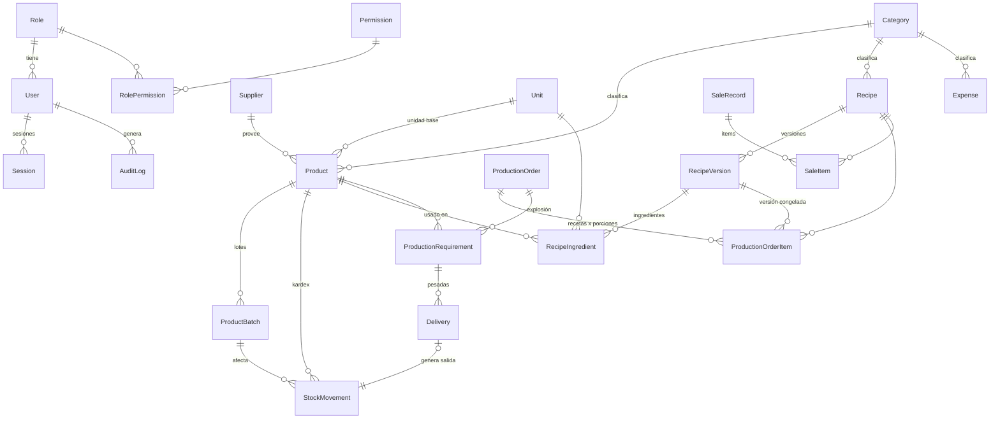

# Fase 3 — Modelo de Datos
## Sistema ERP para Restaurante ("Sistema Gaby")

**Versión:** 1.0 · **Fecha:** 2026-07-06 · **Estado:** Pendiente de aprobación
**Entregables:** este documento · `database/schema.prisma` · `database/seed.ts`
**Nota:** la migración inicial (`prisma migrate dev`) se ejecuta en la Fase 5, cuando exista el proyecto instalado y PostgreSQL corriendo.

---

## 1. Decisiones de diseño

| # | Decisión | Justificación |
|---|---|---|
| DM-01 | **`Decimal` para todo dinero y cantidad** (nunca `Float`) | Precisión contable: `0.1 + 0.2 ≠ 0.3` en flotantes. Dinero `Decimal(14,2)`, costos unitarios `(14,4)`, pesos `(12,3)` (resolución de 1 g). |
| DM-02 | **Tablas de hechos append-only**: `stock_movements`, `deliveries`, `audit_logs` | RN-02. La API no expone UPDATE/DELETE sobre ellas; correcciones = movimientos compensatorios. Refuerzo adicional con `REVOKE UPDATE, DELETE` a nivel de PostgreSQL (migración SQL). |
| DM-03 | **Kardex con `balanceAfter`** en cada movimiento | El saldo histórico queda escrito, no calculado: auditoría instantánea y a prueba de recálculos. |
| DM-04 | **Recetas versionadas** (`recipes` + `recipe_versions` + `recipe_ingredients`) | RF-02.5. `Recipe` guarda identidad y costos *vigentes*; cada edición de ingredientes/pasos crea una versión. Las producciones apuntan a la versión exacta → el histórico nunca se corrompe. |
| DM-05 | **Snapshots de costo** en `production_order_items` (costo/porción y total) y `stock_movements.unitCost` | RN-03: cambiar el precio de un ingrediente recalcula solo los costos vigentes; el pasado queda congelado en las tablas de hechos. |
| DM-06 | **Explosión materializada** en `production_requirements` (una fila por producto consolidado) | RF-04.2. El módulo Inventario lee exactamente esta tabla (su pantalla ES esta tabla). `toleranceApplied` se congela al confirmar para que cambiar la configuración no altere órdenes en curso. |
| DM-07 | **`deliveries` registra también los intentos bloqueados** (`approved=false`) | RF-05.3 + auditoría de "intentos de fraude": cada pesada fuera de tolerancia queda con sus lecturas crudas (`readings` JSON) como evidencia. |
| DM-08 | **Lotes (`product_batches`) con `remainingQuantity`** e índice `(productId, expiryDate)` | FEFO (RN-05) eficiente: el descuento consume lotes ordenados por vencimiento. Alertas de vencimiento salen del mismo índice. |
| DM-09 | **`Category` única con discriminador `kind`** (PRODUCT/RECIPE/EXPENSE) | Tres catálogos idénticos en estructura → una tabla con unique compuesto `(kind, name)`. Menos código, misma integridad. |
| DM-10 | **Permisos granulares** `(resource, action)` en tablas, no hard-code | Matriz §2 del análisis funcional. Roles nuevos = filas nuevas, cero cambios de código. Los 4 roles base llevan `isSystem=true` (no eliminables). |
| DM-11 | **`Sede` desde v1 con FK opcional** en productos y órdenes | Multi-sede futura sin migración dolorosa: hoy `sedeId=null`, mañana se puebla. |
| DM-12 | **IDs `cuid()`** en vez de autoincrementales | No enumerables (seguridad), generables offline, portables entre entornos al restaurar respaldos. `orderNumber` legible ("OP-2026-0001") es aparte, para humanos. |
| DM-13 | **Soft delete universal** (`isActive`) | RN-06. Un producto usado en recetas históricas jamás puede desaparecer (rompería FKs y trazabilidad). |

## 2. Diagrama entidad-relación (núcleo operativo)



Entidades de soporte no diagramadas: `Alert`, `AppSetting`, `Backup`, `Report`, `Sede`.

## 3. Catálogo de tablas (24)

| Área | Tablas |
|---|---|
| Identidad | `roles`, `permissions`, `role_permissions`, `users`, `sessions` |
| Catálogos | `sedes`, `categories`, `suppliers`, `units` |
| Inventario | `products`, `product_batches`, `stock_movements` ⛔ |
| Recetas | `recipes`, `recipe_versions`, `recipe_ingredients` |
| Producción | `production_orders`, `production_order_items`, `production_requirements`, `deliveries` ⛔ |
| Ventas / Gastos | `sale_records`, `sale_items`, `expenses` |
| Sistema | `audit_logs` ⛔, `alerts`, `app_settings`, `backups`, `reports` |

⛔ = append-only (sin UPDATE/DELETE).

## 4. Índices y restricciones clave

**Unique (integridad de negocio):**
`products.code` · `product_batches(productId, batchNumber)` · `recipes(name, categoryId)` ·
`recipe_versions(recipeId, versionNumber)` · `recipe_ingredients(versionId, productId)` ·
`production_orders.orderNumber` · `production_order_items(orderId, recipeId)` ·
`production_requirements(orderId, productId)` · `sale_records.date` (un consolidado por día) ·
`deliveries.movementId` (1 entrega aprobada ↔ 1 salida de stock) · `categories(kind, name)`.

**Índices de consulta (los reportes y pantallas calientes):**
`stock_movements(productId, createdAt)` kardex · `product_batches(productId, expiryDate)` FEFO/alertas ·
`recipe_ingredients(productId)` recálculo en cascada · `production_orders(date, status)` orden del día ·
`audit_logs(createdAt)`, `(userId, createdAt)`, `(resource, resourceId)`, `(kind, createdAt)` ·
`expenses(date)`, `(categoryId, date)` · `alerts(isRead, createdAt)`.

**Restricciones CHECK (Prisma no las modela — van en la migración SQL inicial):**

```sql
ALTER TABLE stock_movements  ADD CONSTRAINT chk_movement_qty_positive CHECK (quantity > 0);
ALTER TABLE product_batches  ADD CONSTRAINT chk_batch_remaining CHECK (remaining_quantity >= 0);
ALTER TABLE products         ADD CONSTRAINT chk_stock_not_negative CHECK ("currentStock" >= 0);
ALTER TABLE production_order_items ADD CONSTRAINT chk_portions_positive CHECK (portions > 0);
ALTER TABLE deliveries       ADD CONSTRAINT chk_delivery_qty_positive CHECK (quantity > 0);
-- Refuerzo de inmutabilidad a nivel de BD (DM-02):
REVOKE UPDATE, DELETE ON stock_movements, deliveries, audit_logs FROM PUBLIC;
```

*(Las tablas append-only además se protegen porque el rol de conexión de la app recibirá
solo INSERT/SELECT sobre ellas; el detalle se aplica en la migración de la Fase 5.)*

## 5. Flujo de datos del ciclo central (validación del modelo)

1. **Admin crea orden** → `production_orders (DRAFT)` + `production_order_items` (con `recipeVersionId` actual).
2. **Confirmar** → transacción: snapshots de costo en items, explosión consolidada a `production_requirements` (convertida a unidad base, con `toleranceApplied` congelada), estado `CONFIRMED`, evento `production:confirmed`.
3. **Bodega pesa** → `deliveries` (approved/bloqueada + lecturas crudas). Si aprobada: `stock_movements (EXIT)` con costo snapshot y `balanceAfter`, consumo FEFO descuenta `product_batches.remainingQuantity` y `products.currentStock`, actualiza `deliveredQuantity`/`status` del requirement.
4. **Todo entregado** → orden pasa a `DELIVERED` → cocina prepara → `COMPLETED` → `CLOSED` (inmutable).
5. **Fin del día** → admin registra `sale_records`/`sale_items` → dashboard cruza ventas − costos (snapshots) − gastos = utilidad.

Cada paso escribe `audit_logs` vía el decorador `withAudit` (AD-07).

## 6. Seed (`database/seed.ts`)

Datos de prueba realistas e idempotentes (upserts):
- 4 roles del sistema con matriz de permisos completa; 4 usuarios (`admin`, `bodega`, `cocina`, `auditor` — clave de desarrollo `Gaby2026*`).
- 7 unidades con factores de conversión; 16 categorías (producto/receta/gasto); 3 proveedores.
- 19 productos colombianos típicos con stock, mínimos, costos en COP y lote inicial (perecederos vencen en 30 días → prueban las alertas FEFO).
- 3 recetas (Almuerzo Ejecutivo, Bandeja Especial, Sopa del Día) con ingredientes, pasos, costos calculados y precio sugerido con margen 60 %.
- Configuración del sistema: tolerancia ±50 g, 5 lecturas estables, alerta de vencimiento a 5 días, backup diario 2 a.m., bloqueo tras 5 intentos.

---

*Siguiente fase (previa aprobación): **Fase 4 — Diseño UI/UX** (sistema de diseño, wireframes de las pantallas clave por módulo, navegación, tema claro/oscuro).*
